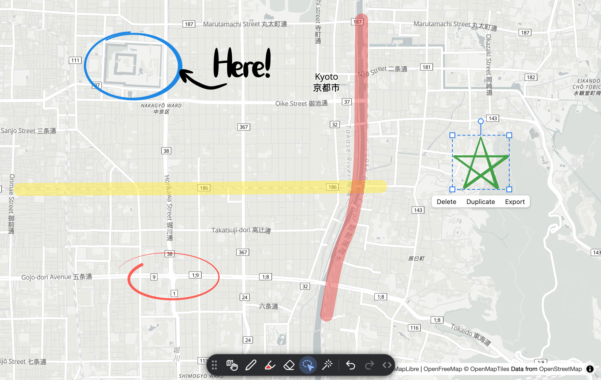

# maplibre-gl-handwriting

A simple freehand drawing plugin for [MapLibre GL JS](https://github.com/maplibre/maplibre-gl-js).

Strokes are kept in map coordinates, tessellated by [lyon](https://github.com/nical/lyon), and drawn by a custom layer.
The plugin draws and edits the strokes of a store you own; saving and sharing them is up to your code.



Map: © [OpenStreetMap](https://www.openstreetmap.org/copyright) contributors, © [OpenMapTiles](https://www.openmaptiles.org/), served by [OpenFreeMap](https://openfreemap.org/).

- A pen and a highlighter with pen pressure, an eraser, a laser pointer, and a lasso to move, scale, rotate,
  duplicate, delete or export strokes
- Undo and redo, keyboard shortcuts, and a toolbar control
- A layer that only shows strokes, and a DOM-free `maplibre-gl-handwriting/core` entry for servers and sync code
- GeoJSON export

## Install

```sh
npm install maplibre-gl maplibre-gl-handwriting
```

`maplibre-gl` (^6.16.0) is a peer dependency.

## Quick start

```js
import { Map } from 'maplibre-gl'
import { createHandwriting, HandwritingToolbar, StrokeStore } from 'maplibre-gl-handwriting'

const map = new Map({ container: 'map', style: 'https://demotiles.maplibre.org/style.json' })
const store = new StrokeStore()
const handwriting = createHandwriting(map, { store })
handwriting.setTool('pen')
map.addControl(new HandwritingToolbar(handwriting))
```

Load the package's `dist/style.css` (`maplibre-gl-handwriting/style.css`), which styles the toolbar, the same way as
`maplibre-gl/dist/maplibre-gl.css`. Where MapLibre cannot find its own worker, give its URL with MapLibre's
[`setWorkerUrl`](https://maplibre.org/maplibre-gl-js/docs/API/functions/setWorkerUrl/).

## Loading the worker and WebAssembly

The package loads its tessellation worker and its WebAssembly module from `dist/assets`, next to its own script, with
`new URL('./assets/…', import.meta.url)`. When they are served from somewhere else, copy `dist/assets` there and pass
the files' URLs as `workerUrl` and `wasmUrl` ([Setup](docs/usage.md#setup)). If they fail to load, the map fires an
`error` event and `handwriting.ready` rejects.

## Example

[examples/basic](examples/basic) is a page with an import map and no build step: install its packages and serve it
with any static file server.

## Documentation

- [docs/usage.md](docs/usage.md): how to draw, save and share strokes, keep settings, and handle errors
- [docs/api.md](docs/api.md): every export, with its type and description
- [CHANGELOG.md](CHANGELOG.md): the changes in each version

## License

MIT ([LICENSE](LICENSE)). The WebAssembly module includes Rust crates under their own licenses
([THIRD_PARTY_LICENSES](THIRD_PARTY_LICENSES)).

The map in the screenshot ([docs/images/screenshot.png](docs/images/screenshot.png)) is © OpenStreetMap contributors, available under the [Open Database License](https://www.openstreetmap.org/copyright), and © OpenMapTiles, not MIT.
